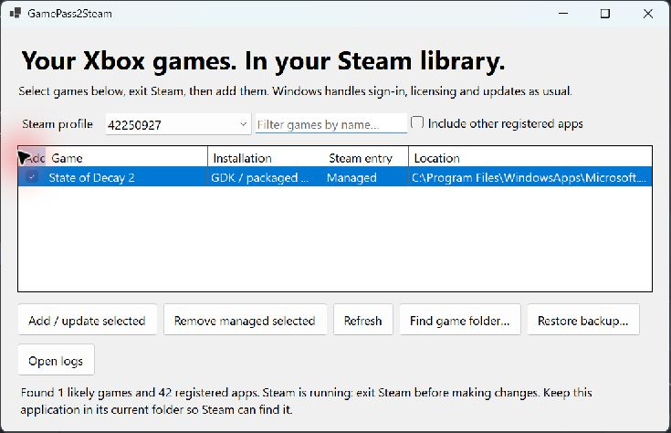
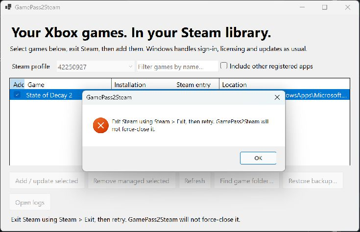
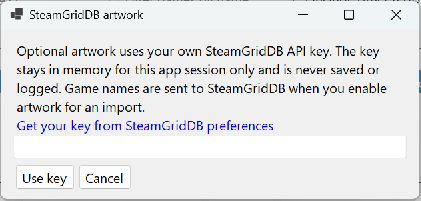

# GamePass2Steam

A Windows application for adding registered Xbox PC games to Steam as non-Steam games. It uses Windows activation, keeps a launcher alive for the detected game session, and safely maintains its own Steam shortcuts.

Version 0.1.0 targets **Windows 10/11 x64**. Windows 11 is the integration test environment. See [verification](docs/VERIFICATION.md) for measured results; launch support does not imply Steam Overlay, Steam Input or Remote Play support.

**[Download the latest release](https://github.com/notmike101/GamePass2Steam/releases/latest)** · **[User wiki](https://github.com/notmike101/GamePass2Steam/wiki)**

## Screenshots

Select installed games and the Steam profile to update. Existing managed entries are identified in the list.



Steam must be fully closed before shortcuts can be changed. The app explains how to exit it and leaves Steam running.



## Install and use

The name filter updates after a brief typing pause (200 ms). Each update reads the current Steam shortcut file; imports and restores refresh immediately.

1. Extract the entire `GamePass2Steam-0.1.0-win-x64.zip` into a **permanent folder**, for example `%LOCALAPPDATA%\Programs\GamePass2Steam`. Keep all files together. No Node.js, pnpm, .NET installation, SDK, administrator privileges or build tools are needed.
2. Run `GamePass2Steam.exe`. Select the intended local Steam profile. The selector uses the locally cached Steam display name (or account name), followed by its numeric ID for disambiguation. Missing or unreadable metadata falls back to the ID. No network or API key is needed. The active profile is selected if Windows provides it; otherwise choose explicitly. Profile IDs match folders under Steam's `userdata` directory and remain the identifiers used by CLI commands.
3. Check games in the Add column. If missing, enable **Include other registered apps**, or use **Find game folder** to match a folder to Windows registration. This fallback accepts a game directory or its Content folder and does not register or modify the game.
4. Use **Steam > Exit**, or click **Add / update selected** while Steam is running and explicitly accept the offer to close and reopen Steam for this import. Save any game progress first; shutdown may interrupt games or downloads. No/Cancel leaves Steam and shortcuts unchanged. The choice is asked each time and is never saved. Closing Steam's window usually leaves Steam running; GamePass2Steam never force-closes it.
5. Click **Add / update selected**, then reopen Steam. Select the game and click **Play**. Xbox/Windows still handles licensing, authentication, saves and updates. Finish any sign-in prompt yourself.
6. Quit from the game's menu. The launcher exits when the matching game process disappears, after a short handoff debounce.

Re-importing updates the launcher location without duplicating the game or changing its existing appid, name, artwork references or other user metadata. Keep the `GamePass2Steam:` tag: it marks ownership. **Remove managed selected** only removes managed Steam entries, including ones whose game was uninstalled; it never uninstalls games. A similarly named unmanaged entry is intentionally preserved.

The optional GUI import waits up to 60 seconds for normal Steam shutdown, then uses the same safe-write checks. If shutdown is refused or times out, nothing is imported. Canceling skips the import but continues observing shutdown so Steam can be reopened if it closes. After a completed shutdown, reopening is attempted even if the import fails. If Steam closes after the timeout or reopening fails, open Steam manually. Removal, restore and CLI commands still require you to exit Steam yourself.

## Optional library artwork

Open **Artwork settings…** and enter your own [SteamGridDB API key](https://www.steamgriddb.com/profile/preferences/api), then enable **Fill missing SteamGridDB artwork** before adding/updating games. The key is masked and kept only in memory until this app closes; it is never saved, logged or included in releases. Artwork is disabled by default, and ordinary imports require neither a key nor network access.



When enabled, game names are sent to SteamGridDB. A unique exact title match (ignoring punctuation, case and trademark symbols) can be selected automatically. Editions, ambiguous results and missing matches open a chooser where you can search another title, enter a SteamGridDB game ID, or skip artwork. Confirmed matches are remembered per shortcut/profile.

Portrait and landscape grids, heroes, logos and icons use high-scoring static PNG assets where available. Existing files and custom icon fields are preserved; repeat imports fill missing categories without re-downloading installed images. Artwork errors never undo successful shortcut imports. Downloads require Steam to remain closed and are placed under the selected profile's `config/grid` using the shortcut's stored AppID. Icons are linked through the same guarded shortcut writer and backups.

Each downloaded file has a `.gp2s-source.json` sidecar recording its source and author. Artwork belongs to its respective rights holders and is not covered by this project's MIT license or bundled into releases. See [the artwork guide](docs/wiki/Artwork.md) for formats, recovery, privacy and limitations.

## Updates and moving the app

Exit GamePass2Steam and any game launched through it. Extract a new release over the same application folder, keeping `GamePass2Steam.exe` at the same absolute path. The shortcut contains a stable AUMID, so package-version/path changes are resolved again at launch. If you move this app, close Steam and re-import the games from the new location. Do not run directly inside the ZIP or delete the folder after importing.

## Backup and recovery

Shortcut changes affect `<Steam>\userdata\<profile>\config\shortcuts.vdf`. Existing files are backed up beside it as `shortcuts.vdf.gp2s-<UTC timestamp>-<unique>.bak`. Writes use a flushed temporary file and atomic Windows replacement. The first creation has no old file to back up. An unchanged import creates no new backup. Keep backups until satisfied with the result; they are not automatically pruned. Optional artwork is saved separately in that profile's `config/grid`; shortcut backups do not include image files.

To restore, exit Steam, choose the same profile, select **Restore backup**, and select the desired `.bak`. Restoration replaces the complete shortcut snapshot and first backs up the current file. Alternatively, with Steam closed, copy the current file somewhere safe and copy the chosen backup to `shortcuts.vdf`. Restore does not affect game installations or saves. If the original file is malformed and the app refuses restoration, use this manual copy procedure. Unknown binary types and malformed input are refused instead of overwritten.

Steam has no supported transactional API for non-Steam shortcuts. Do not start Steam or another shortcut editor while saving. The app checks Steam both before and just before replacement, detects concurrent file changes, and serializes its own writers; this cannot prevent an unrelated process from writing in the final check/replace interval.

## Compatibility and troubleshooting

- **GDK / packaged Win32:** MicrosoftGame.config identifies the real game executable; Windows registration launches its normal bootstrapper. Custom drives/folders work through registration rather than a hardcoded XboxGames scan. Development-only executables are excluded.
- **UWP:** registered applications with a manifest executable use the same activation API and executable/package matching. Xbox Live protocol metadata marks likely games. The optional full app list handles incomplete game metadata. Game Pass subscription ownership cannot be inferred from local registration: purchased Microsoft Store games may also appear.
- Dependencies/resource packages and entries without Start-menu registration or a trackable executable are excluded. DLC without its own visible application is excluded. Visible DLC launchers cannot always be distinguished from games.
- EA, Ubisoft and other external-launcher-only installations, unregistered loose Win32 games, ARM64/x86 builds, elevated/protected processes and games that hand off to an undeclared differently named executable are not supported by this release. Use the official launcher for these. No license bypass or guessed protocol fallback is used.
- A game that needs an update or sign-in may not reach its process within 120 seconds. The launcher reports failure and exits; open it through Xbox, finish setup, then retry. Running it before Steam launch is rejected to avoid claiming an unrelated session.
- A process crash is not proof of successful gameplay. Protected processes that deny inspection can cause tracking to fail. UWP tracking additionally requires a visible application window (including a child of ApplicationFrameHost); minimized windows remain eligible. This prevents suspended background processes from keeping the helper alive after the window closes, but UWP behavior has not been validated on a real game. Launch errors are logged and shown for up to 30 seconds before the helper exits.
- Steam Overlay, Steam Input and Remote Play are separate capabilities and are not promised. The launcher does not inject anything into the game or translate controller input.
- Logs are local at `%LOCALAPPDATA%\GamePass2Steam\logs`. They contain app identity, executable paths, activation/game PIDs and errors; review before sharing. There is no telemetry. Optional artwork lookups contact SteamGridDB only when enabled; API keys and raw artwork service errors are not logged.
- This release is unsigned. Windows may show an unknown-publisher warning; compare the ZIP SHA-256 with its accompanying file and only use a trusted release source.

## Development

Install the .NET 10 SDK on Windows x64. No npm packages are used.

```powershell
dotnet build src/GamePass2Steam -c Release
dotnet run --project tests/GamePass2Steam.Tests -c Release
dotnet run --project src/GamePass2Steam
./scripts/package.ps1
```

The test executable uses isolated temporary profiles, not real Steam configuration. The packaging script runs tests and publishes all runtime files into a fresh staging directory, then creates a ZIP and SHA-256 in `dist`. Windows CI performs the same build and a packaged discovery smoke test in a path containing spaces and Unicode. CI does not verify a licensed game reaches its menu. Local `dist` is ignored by Git.

Feature PRs target `dev`. After review and integration, open a PR from `dev` into `main`; only merging that same-repository PR can publish a release. The release workflow automatically increments the patch version (for example, `0.1.0` to `0.1.1`), runs tests and portable-package checks, then stores the bumped version in a tagged release commit and publishes an immutable versioned ZIP and checksum. It does not push version commits back to protected branches. Direct pushes, feature PR merges into `dev`, other PRs into `main`, and manual build runs do not publish. The old `main-build` rolling prerelease is no longer updated. See [AGENTS.md](AGENTS.md) for contribution rules and [release details](docs/wiki/Releases.md) for retry and promotion guidance.

CLI commands (run the EXE with `Start-Process -Wait -PassThru` in scripts because it is a Windows GUI executable):

```text
GamePass2Steam.exe --discover --output discovery.json
GamePass2Steam.exe --profiles --output profiles.json
GamePass2Steam.exe --import "PackageFamily!ApplicationId" --profile NUMERIC_ID --output result.json
GamePass2Steam.exe --remove "PackageFamily!ApplicationId" --profile NUMERIC_ID --output result.json
GamePass2Steam.exe --restore "C:\path\shortcuts.vdf.gp2s-TIMESTAMP.bak" --profile NUMERIC_ID --output result.json
GamePass2Steam.exe --launch "PackageFamily!ApplicationId"
```

Use the packaged EXE for real imports; importing through `dotnet run` would bind shortcuts to a development executable. The GUI exposes the same operations. Discovery reads only current-user registration. See [research and decisions](docs/RESEARCH.md), [implementation ledger](docs/PROGRESS.md) and [license notices](THIRD-PARTY-NOTICES.md).
