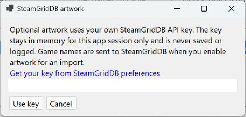

# Optional SteamGridDB artwork

GamePass2Steam can fill missing artwork while adding or updating managed shortcuts. This is optional, disabled by default, and independent of whether a game can be imported or launched.

## Setup

1. Sign in to [SteamGridDB](https://www.steamgriddb.com/) yourself and obtain your own key from [API preferences](https://www.steamgriddb.com/profile/preferences/api).
2. In GamePass2Steam, open **Artwork settings…** and enter the key. It is masked and used only for this application session. Closing the app clears it; enter it again next time.
3. Check **Fill missing SteamGridDB artwork**, select games, exit Steam and choose **Add / update selected**. Alternatively, explicitly accept the one-time Steam close/reopen offer. Artwork finishes while Steam is closed, before the automatic restart.
4. If prompted, select the correct game or skip it. Reopen Steam after artwork processing finishes if you chose manual exit. Once shortcut writing begins, the shutdown-wait cancel button is disabled; you can still skip uncertain artwork matches.

No shared/private API key ships in the application. There is no credential file to copy with the portable app. The feature uses the documented [SteamGridDB API](https://www.steamgriddb.com/api/v2) with an Authorization bearer header; credentials are sent only to the API, never to image downloads. The application does not log keys or raw server responses.

Enabling artwork sends selected game titles and artwork requests to SteamGridDB. Ordinary imports stay offline. Respect the service's current account/API terms; a rejected key or rate limit stops further artwork requests for that operation. Retry later rather than repeatedly importing.

## Choosing the right game

Only a single exact normalized title match is automatic. Punctuation, case and trademark symbols are ignored; edition names and sequel numbers are not stripped. Ambiguous or different editions require a choice. The chooser supports another title search or a numeric **SteamGridDB** game ID (not a Steam AppID), with an explicit **Use selected game** button. **Skip artwork** leaves the successful import intact.

The selected match is recorded in `<AppID>.gp2s-match.json` under that Steam profile's `config/grid`. Repeated imports reuse it. To change a mistaken match, close Steam and the app, remove only that shortcut's `.gp2s-match.json`, then retry and select the right entry. Already-installed images are preserved; replace those manually through Steam if needed.

## Files and preservation

The app reads the actual AppID from the saved managed shortcut. It does not use the SteamGridDB ID or a Steam store ID for filenames.

| Category | Filename under `<Steam>/userdata/<profile>/config/grid` |
| --- | --- |
| Portrait | `<AppID>p.png` |
| Landscape / recent games | `<AppID>.png` |
| Hero | `<AppID>_hero.png` |
| Logo | `<AppID>_logo.png` |
| Icon | `<AppID>_icon.png`, linked from the shortcut's empty icon field |

Static PNG is the supported download format. Portrait requests prefer the API's 600×900/660×930 sizes; landscape requests use 920×430/460×215. Results are ranked by service score. Missing PNG categories are skipped. Images are bounded in size and dimensions, checked for animation, and decoded before installation. Animated PNG, WebP, JPEG and ICO downloads are not implemented; existing custom files in those common formats are still preserved.

Existing artwork is never overwritten by this feature, including a custom icon field. Re-importing fills only missing categories and does not repeatedly download installed images. It does not delete artwork when removing shortcuts. Each installed PNG has a `.gp2s-source.json` sidecar with its SteamGridDB game, asset ID, URL and author. These records provide attribution and help identify files the app added.

Files are written through temporary files and installed without overwriting a destination. Steam must remain closed. If Steam starts or a shortcut changes during lookup, artwork installation stops or skips the affected item. As with shortcuts, avoid running other artwork editors concurrently; no cross-application transaction is available.

## Errors and rights

Authentication, network, invalid-image, unavailable-category, disk-write and rate-limit failures are reported separately from successful shortcut import. Some categories may have finished before a later failure. Retry to fill the remaining categories; custom art stays untouched. Icon-path updates use the existing backup and concurrency checks. Restoring a shortcut backup restores shortcut fields, not downloaded image files.

Artwork remains subject to its creators' and other rights holders' rights. The project license covers application code, not downloaded artwork. Releases contain no SteamGridDB images or credentials. Preserve attribution records and check permissions before redistributing images; API access is not a blanket artwork redistribution license.

Implementation references: [SteamGridDB API specification](https://www.steamgriddb.com/static/openapi.yml), [SteamGridDB artwork FAQ](https://www.steamgriddb.com/faq), and [SteamGridDB's SGDBoop file-placement implementation](https://github.com/SteamGridDB/SGDBoop/blob/main/sgdboop.c). No SGDBoop code is bundled into GamePass2Steam.

PNG response media types are matched without regard to case; image content is still validated before installation.
