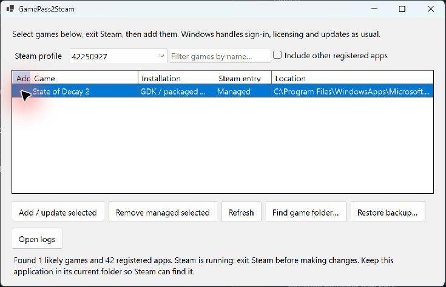

# Getting started

## Requirements

Use Windows 10/11 x64, the desktop Steam client and a game installed and registered for your current Windows account through Xbox or Microsoft Store. Windows 11 is the tested environment. You need a valid license or active subscription for the game. Start it through Xbox once to finish updates and sign-in before importing.

## Install and import

1. Download the application ZIP from [the latest release](https://github.com/notmike101/GamePass2Steam/releases/latest), not GitHub's source-code ZIP. Optionally verify its [SHA-256](Releases).
2. Extract **all files** into a permanent folder, such as `%LOCALAPPDATA%\Programs\GamePass2Steam`. Do not launch inside the ZIP. Keep the executable and runtime files together.
3. Run `GamePass2Steam.exe`. Select your intended Steam profile. The selector shows the locally cached Steam display name (falling back to the account name), plus the numeric profile ID. IDs distinguish accounts with identical names and correspond to Steam's `userdata` folders. If metadata is missing or unreadable, only the ID is shown. This works offline; no Steam Web API key is required. The active account remains selected when Windows identifies it.
4. Check the games in the **Add** column. Search by name if needed. **Include other registered apps** expands the list when game metadata is incomplete. **Find game folder** matches a game directory or its Content folder to an existing Windows registration; it does not register loose executables.
5. Choose **Steam > Exit**, or leave Steam running and accept the GUI's one-time offer to close and reopen it when you click **Add / update selected**. Save game progress first: games and downloads may be interrupted. No/Cancel makes no changes. This is asked for each import and is not a saved preference.
6. Click **Add / update selected**, then reopen Steam. Your entries appear as non-Steam games.
7. Select a game in Steam and click **Play**. Complete any Xbox/Windows account prompts yourself.

## Check the session

While the game is open, Steam should show **Running** and a **Stop** button; Friends presence should show the shortcut's game name. Quit using the game's normal menu. Once the detected game process exits, the launcher allows a short handoff delay and exits; Steam should return to **Play** and ordinary online presence.

State of Decay 2 passed this launch/presence/exit sequence on Windows 11. That does not establish compatibility with every game, Steam Overlay, Steam Input or Remote Play. See [Compatibility](Compatibility).

Keep the application folder after importing: Steam shortcuts launch its EXE. See [Managing shortcuts](Managing-Shortcuts) before moving or uninstalling it.
