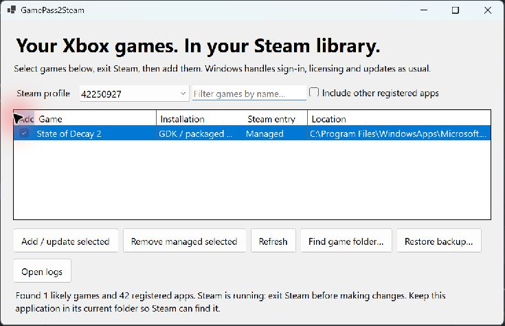

# GamePass2Steam user guide

Add registered Xbox PC and Microsoft Store games to Steam, then launch them from your Steam library. Windows continues to handle licensing, sign-in, updates and saves. GamePass2Steam stays running while it can detect the game session so Steam can show you in the game.

**[Download the latest version](https://github.com/notmike101/GamePass2Steam/releases/latest)** · [Source and README](https://github.com/notmike101/GamePass2Steam) · [Report a problem](https://github.com/notmike101/GamePass2Steam/issues)

- [Getting started](Getting-Started): requirements, installation and your first Steam launch.
- [Managing shortcuts and backups](Managing-Shortcuts): updates, removal, moving the app and recovery.
- [Compatibility](Compatibility): supported discovery methods, tested behavior and limitations.
- [Troubleshooting](Troubleshooting): missing games, Steam status, launch errors and useful reports.
- [Releases](Releases): stable versions, latest main builds and checksum verification.

The first release is a portable, unsigned Windows x64 app with its .NET runtime included. It does not need administrator access or a separate .NET installation. It is an independent project and is not affiliated with Microsoft, Xbox or Valve.
