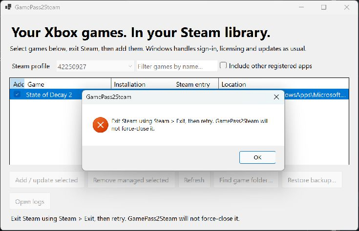

# Troubleshooting

## “Exit Steam using Steam > Exit”

Closing Steam's window is not enough. Use its **Steam > Exit** command, wait for it to finish, then retry. GUI imports also offer to request a normal shutdown and reopen Steam, with explicit consent each time. Removal, restore and CLI commands still require manual exit. GamePass2Steam never force-kills Steam or saves while it is detected running.

The optional import waits up to 60 seconds. If Steam refuses to exit or times out, no shortcuts are changed. **Cancel import** skips writing but continues watching for shutdown so Steam can be reopened; this can take the remainder of the timeout. If Steam closes later, reopen it manually. A reopening failure is reported separately, including whether the shortcut operation completed.

## My game is missing

An unreadable or malformed shortcuts file is reported in the status line when filtering or changing **Include other registered apps**. Release the file lock or repair the file, then retry the filter.

Choose **Refresh**, clear the search field and try **Include other registered apps**. Confirm the game is installed for this Windows account and opens from Xbox. **Find game folder** can match its install folder or Content folder to a registered application. It cannot add an unregistered executable or make an external launcher game compatible. Check [Compatibility](Compatibility).

## It opens from Xbox but not from Steam

Finish updates and sign-in in Xbox, quit the game, then launch from Steam. An already-running game is rejected so the helper does not claim someone else's session. Startup has a 120-second limit; errors are logged and displayed for up to 30 seconds before the helper exits.

If you moved GamePass2Steam, exit Steam and re-import from its new permanent folder. Confirm the whole release ZIP was extracted and runtime files remain next to the EXE. Do not substitute an individual EXE from a different version.

## Steam stops showing the game too early, or keeps showing it after exit

Check whether the actual game executable is still running. A game may leave a background process, deny process inspection, or hand off to an executable not declared in its package metadata. Report the game/version, installation type, observed Steam state and relevant logs. Do not infer successful tracking just because the game appeared on screen.

After a normal detected game exit, allow a few seconds for the helper's handoff debounce and Steam's UI to update. If stuck, use Steam's normal **Stop** control after saving and closing the game; report the issue before relying on that title's tracking.

## Wrong profile or missing shortcuts after restart

Check the selected numeric Steam profile against the account's `userdata` directory. Close Steam before re-importing. Leave the ownership tag intact. If another editor or Steam overwrote changes, use [backup recovery](Managing-Shortcuts) and retry with both closed.

## Windows reports an unknown publisher

The release is unsigned. Get it from the [official repository releases](https://github.com/notmike101/GamePass2Steam/releases) and compare the ZIP's [SHA-256](Releases). A checksum detects corruption or a mismatch; it is not a code-signing identity. Do not disable antivirus or system security features to make the app work.

## Reporting a useful issue

Open an [issue](https://github.com/notmike101/GamePass2Steam/issues) with the app version, Windows version, game name, installation source, exact error, steps to reproduce, and whether Steam presence was correct during and after the session. Mention whether the game launches directly through Xbox.

Use **Open logs** to find `%LOCALAPPDATA%\GamePass2Steam\logs`. Review logs before attaching: they may include local paths, app identities, PIDs and errors. Remove private information. Do not upload credentials, full Steam userdata, saves or account screenshots. The app has no telemetry and sends no automatic reports.
